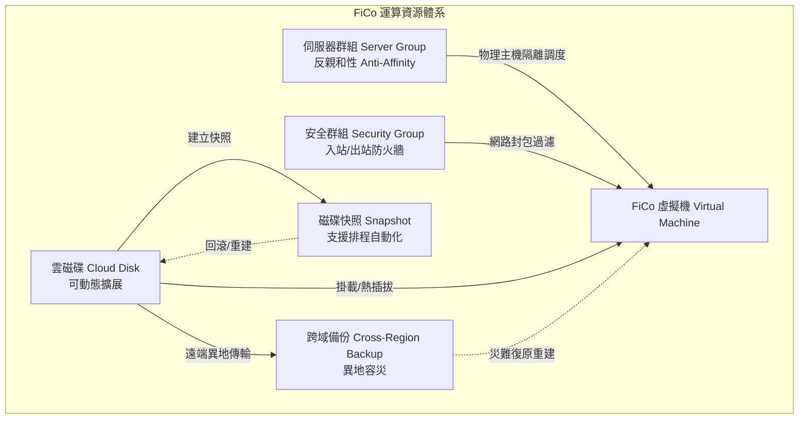

# FiCo 計算機服務 (Compute Service)

本文件彙整自《FiXo User Portal Manual v5.4.1.0》第 6 章，詳解 FiXo 彈性雲端運算架構、虛擬機生命週期、儲存磁碟與快照備份、反親和性伺服器群組及虛擬防火牆安全機制。

---

## 🌟 3D 政策島（Heart Island）場景導覽
* **3D 展館地標**：⚡ **鴻海高軟 AI 超算中心**
* **六角島嶼座標**：Axial Hex `(q: 1, r: -2)` ｜ 3D 世界座標：`(0.0, 0.65, -25.5)`
* **所屬聚落**：高雄軟體科技園區 · 北側深水算力核心島
* **場景建築概念**：雙子結構超算機房大樓，立面搭配深藍發光晶片散熱鰭片與高聳避雷通訊針塔，象徵鴻海在高雄軟體園區建置的千卡 GPU 算力集群與企業核心虛擬化底座。
* **探索互動方式**：探索員小人登島後，靠近主機房信標光環即可觸發彈窗，檢視 VNC Web 控制台、反親和性伺服器群組、磁碟在線擴展與跨區域異地備份等功能。

---

## 1. 產品定位與運算架構

FiCo（Compute Service）為 FiXo 雲端平台的核心運算引擎，提供高可用性、高彈性的虛擬機（Virtual Machines）與區塊儲存資源。支援多種 Linux 及 Windows 作業系統環境，具備秒級開機、彈性規格升降、即時效能監控、跨實體機反親和性容災及跨區域災難復原能力。



---

## 2. 虛擬機全生命週期管理 (Virtual Machine)

### 2.1 虛擬機建立核心要素
建立虛擬機前，須準備 **金鑰對（Keypair）** 與 **租戶網路（VPC Subnet）**：
1. **基本配置**：主機名稱、可用區域（AZ）、選擇關聯之**伺服器群組**。
2. **映像檔（Image）**：提供官方標準版 Linux（Ubuntu、CentOS 等）及 Windows Server 映像檔，亦支援使用者自訂映像檔。
3. **運算規格（Flavor）**：依 CPU 核心數與記憶體比例（vCPU / RAM）彈性選配。
4. **系統磁碟與資料磁碟**：
   * 磁碟類型包含高效雲磁碟與超高效雲磁碟。
   * 可在建立時直接加掛多顆獨立資料磁碟。
5. **網路與安全**：指派 VPC 內部子網 IP、指派或關聯外部浮動 IP、勾選套用的安全群組。
6. **認證方式**：
   * Linux：強制或建議選用 SSH 金鑰對登入。
   * Windows：透過金鑰對加密初始管理者密碼，或自訂登入密碼。
7. **初始化配置（User Data / Cloud-init）**：支援在啟動時注入 Shell 腳本自動執行軟體安裝與初始化設定。

### 2.2 運維、監控與管理作業
* **即時效能監控（Performance Metrics）**：內建視覺化監控看板，即時採集 **vCPU 使用率**、**記憶體佔用率**、**磁碟讀寫 IOPS / 吞吐量** 及 **網路進出流量（Network I/O）**。
* **虛擬機日誌（Console Log）**：直讀實體主機底層輸出的開機與系統核心 Console Log，便於排查系統啟動故障。
* **VNC 網頁控制台（Web Console）**：
  * 提供免客戶端之瀏覽器圖形化/終端連線。
  * 專屬提供 **「Send Ctrl+Alt+Del」** 功能，解決 Windows 系統登入解鎖按鍵被本機攔截的問題。
* **取得 Windows 預設密碼**：使用者上傳建立主機時指定的 SSH 私鑰檔（.pem），系統在前端解密取得 Administrator 預設密碼。
* **開關機與重啟機制**：
  * **軟重啟（Soft Reboot）**：透過 ACPI 發送作業系統優雅重啟信號，確保資料刷盤寫入。
  * **硬重啟（Hard Reboot）**：強制硬體層斷電重開，用於作業系統卡死時的強制復原。
* **動態規格變更（Resize Flavor）**：支援升降級 vCPU 與記憶體規格（變更前建議關機）。
* **DNS 與網路微調**：支援自訂虛擬機專屬的 DNS 解析伺服器 IP，以及熱插拔次要浮動網卡。
* **標籤與備忘錄**：提供資源維度 Tag 標記，以及內部維運人員交接備忘錄紀錄。
* **安全刪除機制**：需手動輸入虛擬機名稱確認刪除，並可勾選是否一併連帶釋放系統磁碟與掛載的資料磁碟。

### 2.3 遠端連線指南
* **Linux 主機 (SSH)**：
  ```bash
  ssh -i <your-keypair.pem> <username>@<floating-ip>
  ```
* **Windows 主機 (RDP)**：透過遠端桌面連線程式（mstsc），連線目標浮動 IP 之 `3389` 連接埠，並輸入解密後取得的管理者密碼。
* **獨立 VNC 工具**：支援以標準 VNC 用戶端連線特定轉發連接埠。

---

## 3. 儲存架構與資料保護

### 3.1 雲磁碟 (Cloud Disk / EVS)
* **磁碟彈性掛載**：獨立於虛擬機生命週期的持久性區塊儲存，支援掛載至任意主機（如 `/dev/vdb`）與隨時卸載。
* **在線擴展容量（Expansion）**：業務資料增長時，可直接在雲端管理介面進行磁碟容量擴增（僅支援擴大，不支援縮減），擴展後需至作業系統內部進行分區擴容（resize2fs / growpart）。
* **磁碟類型變更**：支援因應效能需求轉換底層儲存型別。

### 3.2 磁碟快照 (Disk Snapshot) 與回滾
* **時間點快照**：保留特定時間點的區塊資料增量快照。
* **三大多重復原路徑**：
  1. **回滾雲磁碟（Rollback）**：將原始磁碟資料無失真倒退至快照建立當下的狀態。
  2. **從快照重建雲磁碟**：複製一份全新的獨立雲磁碟，便於資料比對或掛載至測試主機。
  3. **從快照重建虛擬機**：以此快照為開機根目錄重建一台全新虛擬機。

### 3.3 自動化快照排程 (Snapshot Schedule)
* 避免手動備份遺漏，使用者可設定策略排程：
  * **關聯磁碟**：單一或多顆雲磁碟。
  * **週期頻率**：支援按天、按週、按月或固定時間點觸發。
  * **生命週期輪轉**：設定最大快照保留份數，超出配額時系統自動覆蓋最舊快照，兼顧安全與儲存成本。
  * **排程日誌**：記錄每一次定時作業的執行成果與異常告警。

### 3.4 雲磁碟備份與跨域備份 (Cross-Region Backup)
* **雲磁碟備份**：基於物件層級的深度冷備份，與主體運算叢集故障域隔離。
* **跨域異地備份**：
  * 支援將備份資料跨地域傳輸至異地可用區（如不同城市或數據中心）。
  * 在極端災難狀況下，可於異地資料中心直接**從跨域備份重建雲磁碟**或**重建整台虛擬機**，達成企業級 RPO / RTO 容災標準。

---

## 4. 運算高可用與網路安全防護

### 4.1 伺服器群組 (Server Group) - 反親和性調度
* **反親和性策略（Anti-affinity / Soft Anti-affinity）**：
  * 在部署叢集服務（如 DB 主從架構、K8s 節點群、負載平衡集群）時，將節點劃入同一個反親和性伺服器群組。
  * 底層排程器強制將群組內的虛擬機**分配到不同的實體伺服器主機**上，徹底杜絕因單一實體伺服器硬體損毀造成全體服務中斷的單點故障（SPOF）。

### 4.2 安全群組 (Security Group) - 虛擬防火牆
* **有狀態封包過濾（Stateful Firewall）**：預設封鎖所有外部連線，出站流量預設全開。
* **規則設定維度**：
  * **方向**：入站（Ingress）與 出站（Egress）。
  * **網路協定**：TCP、UDP、ICMP（Ping）、任意協定（ALL）。
  * **通訊埠範圍**：支援單一 Port（如 22, 80, 443）或範圍區間（如 8000-8080）。
  * **來源/目的授權**：
    * **CIDR 網段**：如 `0.0.0.0/0`（全網公開）或指定內部網段 `10.0.0.0/16`。
    * **安全群組引用（Security Group Reference）**：直接指定另一個安全群組 ID，僅允許屬於該群組的虛擬機互通，大幅簡化微服務架構的防火牆維護。

### 4.3 SSH 金鑰對管理 (Keypair)
* **系統生成**：由系統產生高強度 2048 位元 RSA 金鑰對，私鑰僅在建立當下提供下載一次（.pem），平台不代為保管私鑰以確保零信任安全。
* **公鑰導入**：支援直接貼上使用者現有的 OpenSSH 公鑰文字檔（`~/.ssh/id_rsa.pub`），集中指派給新虛擬機。
