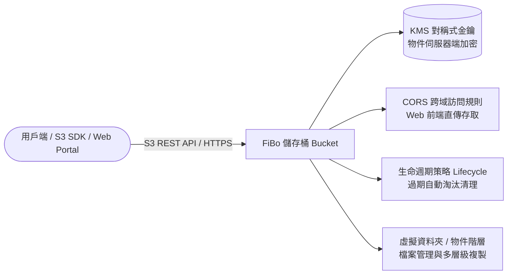

# FiBo 物件儲存服務 (Object Storage Service)

本文件彙整自《FiXo User Portal Manual v5.4.1.0》第 7 章，說明 FiXo 雲端平台之分散式物件儲存架構、S3 相容 API 串接、儲存桶安全權限、生命週期管理及防中斷上傳機制。

---

## 🌟 3D 政策島（Heart Island）場景導覽
* **3D 展館地標**：⚓ **高雄港數據深水海港**
* **六角島嶼座標**：Axial Hex `(q: 1, r: -1)` ｜ 3D 世界座標：`(7.4, 0.65, -12.8)`
* **所屬聚落**：高雄軟體科技園區 · 東北臨海深水海港島
* **場景建築概念**：以揚帆啟航的「數據方舟」船塢為核心意象，周圍環繞海浪浮標與防波提，象徵相容 AWS S3 API 的無限吞吐資料湖，海納亞灣海港一切非結構化數據。
* **探索互動方式**：探索員小人可自中央島經東北拱橋步行登島，觸發地標信標即可查閱 S3 三級 ACL、大檔防自動登出中斷專利機制、KMS 伺服器端加密（SSE）與生命週期淘汰排程。

---

## 1. 產品定位與核心架構

FiBo（Object Storage Service）為高擴展性、高耐久性與高安全性的海量非結構化資料儲存服務。全面相容 Amazon S3 API 協定，支援透過 AWS CLI、S3 Browser、SDK 或管理入口存取資料，廣泛應用於靜態網站託管、巨量資料湖、多媒體歸檔儲存及跨系統資料交換。

---

## 2. 儲存桶管理 (Bucket)

### 2.1 儲存桶總覽與建立
* **即時統計看板**：進入服務首頁即展示當前專案下的 **儲存桶總數** 與 **當日累積下載流量（Data Egress）**，利於監控用量與成本。
* **建立儲存桶規範**：自訂全域唯一名稱，並指派初始之存取控制清單（ACL）層級。

### 2.2 存取控制清單 (ACL) 三大層級
FiBo 提供顆粒度明確的儲存桶存取控制權限：

| ACL 權限層級 | 讀取權限 (Read) | 寫入/刪除權限 (Write) | 典型適用情境 |
| :--- | :--- | :--- | :--- |
| **私有讀寫 (Private)** | 僅擁有者或獲授權身分 | 僅擁有者或獲授權身分 | 存放機密文件、企業內部資料庫備份、核心業務日誌。 |
| **公有讀、私有寫 (Public Read)** | 網際網路所有人皆可匿名讀取 | 僅限擁有者或獲授權身分 | 公開網站圖片素材、影音影音檔發布、軟體安裝包下載站。 |
| **公有讀寫 (Public Read Write)** | 網際網路所有人皆可匿名讀取 | 網際網路所有人皆可匿名寫入 | 完全開放的臨時公共資料交換站（高安全風險，需審慎評估）。 |

* **ACL 動態修改**：儲存桶建立後，可隨時透過「設定存取控制清單」重新調整權限層級。
* **刪除儲存桶防護**：儲存桶內若仍殘留任何物件或資料夾，系統禁止執行刪除；**必須先清空所有內容方可刪除儲存桶**。

---

## 3. 檔案與物件深度管理 (Object Operations)

### 3.1 檔案與資料夾階層
* **虛擬目錄結構**：支援建立多層次虛擬資料夾，並提供 **「導向資料夾功能」**，可直接輸入絕對/相對路徑字串瞬間跳轉至目標目錄。
* **物件操作維度**：
  * **單一/批次下載**。
  * **線上編輯名稱**：快速變更已儲存物件之顯示名稱。
  * **複製物件（Object Copy）**：支援在同儲存桶不同路徑間或**跨儲存桶（Cross-Bucket）**快速複製資料，無需下載至本機再重新上傳。
  * **屬性檢視**：可檢索物件識別碼、檔案大小、MIME Content-Type、最後修改時間及存取 URL。

### 3.2 大檔防中斷上傳機制與伺服器端加密
* **防閒置自動登出中斷（關鍵設計）**：
  * 在上傳大容量檔案時，因使用者長時間未操作介面，容易觸發平台的「30 分鐘無操作自動登出」機制導致傳輸中斷。
  * FiBo 在上傳頁面提供專屬選項：**「是否同意於上傳期間暫停自動登出機制」**。勾選後系統將維持傳輸會話直到上傳結束，徹底解決大型檔案上傳失敗的痛點。
* **物件加密 (Server-Side Encryption)**：
  * 上傳時可選擇關聯 **KMS 對稱式金鑰**，資料在寫入底層磁碟時自動加密，讀取時透明解密，確保資料靜態儲存安全（Data-at-Rest Protection）。

---

## 4. 進階資料管理與存取協定

### 4.1 跨域資源共享 (CORS - Cross-Origin Resource Sharing)
為允許前端 Web 應用程式透過瀏覽器直接向 FiBo 發送 Ajax / Fetch 請求，需設定 CORS 規則：
* **允許來源（Allowed Origins）**：指定特定網域名稱（如 `https://example.com`）或萬用字元 `*`。
* **允許方法（Allowed Methods）**：支援 `GET`、`PUT`、`POST`、`DELETE`、`HEAD`。
* **允許標頭（Allowed Headers）** 與 **暴露標頭（Expose Headers）**。
* **快取時間（Max Age Seconds）**：瀏覽器預檢請求（OPTIONS）結果的快取有效秒數。

### 4.2 生命週期管理 (Lifecycle)
* **自動清理過期資料**：企業產生的日誌或暫存資料可配置自動淘汰排程。
* **規則設定項目**：
  * **路徑前綴（Prefix Filter）**：指定特定目錄（例如 `logs/2026/`）或全域生效。
  * **過期天數（Days）**：物件建立滿指定天數後，背景排程自動刪除清理。
  * **靈活切換**：支援針對個別生命週期規則隨時執行「啟用」或「停用」。

### 4.3 FiBo S3 金鑰對管理 (S3 Credentials)
* **SecretId 與 SecretKey**：使用標準 S3 工具（如 s3cmd、MinIO Client、AWS SDK、rclone）存取 FiBo 必備之 API 憑證。
* **權限細部配置**：可設定金鑰對的存取範圍（唯讀 Read-Only、讀寫 Read-Write 或完整管理權限 Full Control）。
* **憑證輪替**：支援一鍵複製金鑰字串，並可在金鑰洩漏風險時立即刪除並重建新金鑰對。
