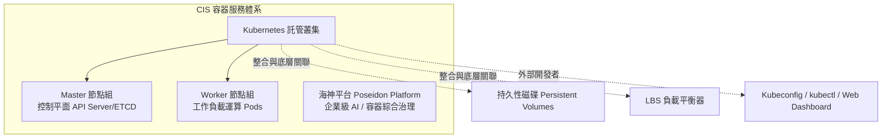

# CIS 容器基礎設施服務 (Container Infrastructure Service)

本文件彙整自《FiXo User Portal Manual v5.4.1.0》第 9 章，說明 FiXo 雲原生容器託管服務、Kubernetes 叢集全生命週期、節點組彈性擴縮、私有映像倉庫認證及海神平台（Poseidon Platform）。

---

## 🌟 3D 政策島（Heart Island）場景導覽
* **3D 展館地標**：🐳 **旅運中心海神容器碼頭**
* **六角島嶼座標**：Axial Hex `(q: 1, r: 0)` ｜ 3D 世界座標：`(14.7, 0.65, 0.0)`
* **所屬聚落**：高雄軟體科技園區 · 東部旅運貨櫃深水島
* **場景建築概念**：以高雄港旅運中心流線型建築與現代化貨櫃碼頭為原型，立有海藍色的海神龍門吊架與層疊彩色貨櫃（象徵 Kubernetes 微服務 Pods），展現雲原生應用的極速裝載與彈性伸縮。
* **探索互動方式**：探索員小人自中央島東側拱橋前往碼頭，靠近信標即可展開手冊彈窗，深入了解 Master/Worker 節點組劃分、在線自動擴縮容、內部 Harbor 鏡像倉庫配置及「海神平台（Poseidon）」一站式 AI 容器治理。

---

## 1. 產品定位與容器生態架構

CIS（Container Infrastructure Service）提供企業級標準化的 Kubernetes 託管叢集與雲原生應用運行環境。整合底層 VPC 虛擬網路、雲磁碟持久儲存（CSI）與 LBS 負載平衡器，讓開發與維運團隊可專注於微服務應用的交付與治理，無需操心底層控制平面的維護複雜度。



---

## 2. Kubernetes 託管叢集全生命週期管理

### 2.1 叢集建立核心四步
建立叢集前，須在目標區域準備好 **VPC 租戶網路與子網**：
1. **基本資訊設定**：自訂叢集名稱、選擇 Kubernetes 核心版本、指定叢集全域自訂 DNS 解析位址。
2. **Master 控制節點配置**：
   * 選擇運算規格（Flavor：vCPU / RAM）。
   * 設定節點數量（高可用叢集建議多節點 Master 架構）。
   * 選擇系統磁碟型別與容量（GB）。
3. **Worker 初始工作節點配置**：
   * 選擇承載應用負載的工作機規格、初始節點數量與資料磁碟配置。
4. **網路與相依性關聯**：綁定指定的 VPC 虛擬網路與子網，由平台自動建立網路介面與安全通道。

### 2.2 關聯資源透視
在 Kubernetes 詳細資料頁面中，除展示狀態、健康度、API Server 存取端點、核心版本外，還集中收攏關聯的底層雲端資源：
* **持久性磁碟列表（Persistent Disks）**：由 Kubernetes PVC 自動動態申請或手動掛載的雲磁碟實例。
* **磁碟快照列表（Volume Snapshots）**：針對容器資料卷保留的歷史備份。
* **負載平衡器列表（Load Balancers）**：透過 K8s `Service Type: LoadBalancer` 自動佈署關聯的 LBS 實例。

---

## 3. 節點組深度運維 (Node Groups)

### 3.1 Master 節點組 vs. Worker 節點組
* **Master 角色**：負責叢集控制平面的資源調度、Controller 循環、API 請求響應及叢集狀態監控。
* **Worker 角色**：負責調度並運行容器化 Pod 業務負載。

### 3.2 彈性擴縮容 (Node Scaling)
* 支援因應業務流量高峰或低谷，即時進入節點組介面調整目標節點數量（Scale Up / Scale Down）。
* 縮容時系統依序優雅驅逐（Drain）現有 Pod 並釋放運算實例，確保業務不中斷。

### 3.3 私有鏡像倉庫配置 (Private Registry)
* 在企業封閉環境中，節點需拉取內部 Docker / Harbor 鏡像倉庫的容器映像檔。
* 透過 **「編輯鏡像倉庫」** 功能，可直接在節點組層級設定私有 Registry 的網址端點、存取帳號與認證密碼，免除逐台節點手動配置 Docker Daemon 的繁瑣作業。

### 3.4 節點組自訂 DNS
* 支援修改節點組使用的 DNS 伺服器 IP，以支援企業內部網域解析或混合雲 DNS 轉發需求。

---

## 4. 叢集存取與外部工具鏈整合

### 4.1 Kubernetes 入口網站 (Dashboard)
* 平台內建一鍵跳轉官方 **Kubernetes Web UI (Dashboard)**。
* 具備圖形化檢視 Workloads（Deployments, StatefulSets, DaemonSets）、Pods、Services、Ingress 與 ConfigMaps 之能力。

### 4.2 叢集即時監控看板
* 即時呈現叢集整體與節點層級的 CPU、記憶體佔用曲線、節點健康評分與事件警示。

### 4.3 Kubeconfig 設定檔下載
* 管理者可直接下載專屬的 **`kubeconfig`** 設定檔。
* 配合本機終端機的 `kubectl` 命令列工具，即可直接透過指令操作叢集：
  ```bash
  kubectl --kubeconfig=kubeconfig.yaml get nodes
  kubectl --kubeconfig=kubeconfig.yaml get pods -A
  ```

---

## 5. 海神平台 (Poseidon Platform)

* **產品特色**：海神平台為建立於容器基礎架構之上的企業級 AI 與容器綜合應用管理平台。
* **操作與治理**：提供專屬的平台管理列表、獨立的**海神平台入口網站**跳轉通道，支援更高層級的企業工作負載與人工智慧模型調度。
