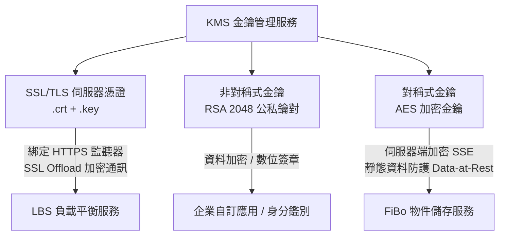

# KMS 金鑰管理服務 (Key Management Service)

本文件彙整自《FiXo User Portal Manual v5.4.1.0》第 10 章，詳述 FiXo 雲端安全加密核心、SSL/TLS 數位憑證生命週期、非對稱與對稱式密碼學金鑰管理及跨服務安全整合。

---

## 🌟 3D 政策島（Heart Island）場景導覽
* **3D 展館地標**：🔐 **亞灣金融密鑰金庫**
* **六角島嶼座標**：Axial Hex `(q: -1, r: 1)` ｜ 3D 世界座標：`(-7.4, 0.65, 12.8)`
* **所屬聚落**：高雄軟體科技園區 · 南部地脈花崗岩金庫島
* **場景建築概念**：深嵌於亞灣堅固的花崗岩地基之中，頂部旋轉懸浮著晶瑩的粉紅密碼防護力場，象徵硬體級安全金庫，負責守護全島最核心的數位憑證與加密密鑰。
* **探索互動方式**：探索員小人自中央島南向拱橋抵達金庫，靠近信標即可調閱手冊內容，了解 SSL/TLS 憑證「使用中（In Use）嚴禁刪除」保護機制、RSA 2048 非對稱金鑰生成與 FiBo 伺服器端加密（SSE）聯動。

---

## 1. 產品定位與跨服務架構

KMS（Key Management Service）為 FiXo 平台的集中式密碼學安全中心，提供伺服器憑證管理、非對稱金鑰對（Asymmetric Keys）與對稱金鑰（Symmetric Keys）的生成、儲存與授權保護。

---

## 2. SSL/TLS 伺服器憑證管理 (Certificates)

### 2.1 憑證建立與格式支援
* **支援上傳副檔名**：支援標準副檔名 `.pem`、`.crt`、`.pub`、`.key` 檔案。
* **建立流程**：
  1. 輸入憑證管理名稱與描述。
  2. 上傳伺服器數位憑證檔案（CRT / PEM，需包含中繼 CA 證書鏈）。
  3. 上傳對應之伺服器私鑰檔案（Private Key）。
  4. 系統校驗公私鑰配對一致性，寫入安全金鑰儲存庫。

### 2.2 跨服務串接與「使用中」防護限制
* **LBS HTTPS 卸載**：建立 LBS HTTPS 監聽器時，可直接由憑證清單下拉選取 KMS 憑證，由負載平衡器統一處理 SSL 握手。
* **刪除阻擋防護機制（關鍵安全規則）**：
  * 當憑證已被 LBS 監聽器或雲端服務引用時，系統會自動將該憑證標記為 **「使用中（In Use）」**。
  * **處於「使用中」狀態的憑證嚴禁刪除**，防止使用者誤刪導致對外公網 HTTPS 服務瞬間癱瘓。
* **不可逆警告**：已刪除的憑證無法復原，關聯之已加密資料將面臨無法再行解密之風險。

---

## 3. 非對稱式金鑰 (Asymmetric Keys)

### 3.1 演算法規範與建立途徑
* **適用情境**：非對稱式金鑰由一對數學關聯的公鑰與私鑰組成，主要用於端到端資料傳輸加密、API 請求之數位簽章（Digital Signature）與跨系統身分鑑別。
* **兩種建立途徑**：
  1. **系統自動生成（預設推薦）**：系統透過高強度亂數產生器直接生成 **RSA 2048 位元** 金鑰對，即建即用。
  2. **自行上傳**：關閉自動建立開關，自行提供線下產生的公鑰與私鑰文字檔案。

### 3.2 詳細內容與檢視
* 支援在控制台中直接檢視金鑰狀態、關聯服務、並提供「一鍵複製公鑰」功能供外部系統對接。

---

## 4. 對稱式金鑰 (Symmetric Keys)

### 4.1 演算法與核心應用
* **加密原理**：加密與解密採用完全相同的單一密鑰（例如 AES-256 演算法），具備極高之加解密運算效能。
* **FiBo 物件儲存原生整合**：
  * 對稱式金鑰深度嵌合於 [FiBo 物件儲存服務](04_FiBo_物件儲存服務.md)。
  * 當使用者上傳大容量檔案或機密數據時，可直接勾選指定的 KMS 對稱金鑰，系統在資料落盤（Disk Write）時自動執行伺服器端加密（SSE），防止底層硬體失竊外洩。

### 4.2 生命週期與刪除確認
* 刪除對稱式金鑰時觸發二次確認視窗，務必確認已無任何加密中的物件相依於該金鑰，否則原加密檔案將永久損毀無法還原。
