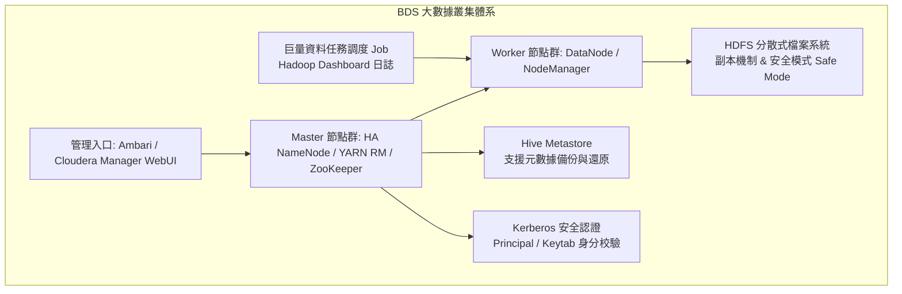

# BDS 大數據服務 (Big Data Service)

本文件彙整自《FiXo User Portal Manual v5.4.1.0》第 12 章，深入分析 FiXo 分散式巨量資料處理架構、Hadoop/Spark 叢集生命週期、HDFS 分散式儲存維運、高可用架構（HA）、Kerberos 企業資安認證與巨量任務調度。

---

## 🌟 3D 政策島（Heart Island）場景導覽
* **3D 展館地標**：📊 **音浪大數據觀測站**
* **六角島嶼座標**：Axial Hex `(q: 0, r: 2)` ｜ 3D 世界座標：`(14.7, 0.65, 25.5)`
* **所屬聚落**：高雄軟體科技園區 · 東南外海音浪島
* **場景建築概念**：以高雄流行音樂中心「音浪塔」與六角展演蜂巢波浪為設計靈感，頂部幾何波浪隨著巨量資料串流而律動，象徵全天候彙整高雄智慧港灣與車聯網的巨量資料浪潮。
* **探索互動方式**：探索員小人自工作站島沿木棧道前往觀測站，觸發信標即可展開大數據手冊，查閱 HDP/CDH 叢集架構、HDFS 安全模式副本修復、DataNode 優雅下線（Decommission）防資料遺失與 Kerberos 企業認證。

---

## 1. 產品定位與分散式運算架構

BDS（Big Data Service）為全代管的企業級分散式巨量資料運算與儲存服務。支援業界主流的 **HDP（Hortonworks Data Platform）** 與 **CDH（Cloudera Distribution including Apache Hadoop）** 發行版，開箱即用支援 HDFS、YARN、MapReduce、Hive、Spark、ZooKeeper 等大數據核心生態組件。



---

## 2. 大數據叢集生命週期管理 (Cluster Management)

### 2.1 叢集部署前置條件
* **金鑰對（Keypair）**：用於叢集底層節點間免密碼通訊與管理員維運 SSH 存取。
* **VPC 租戶網路**：確保各節點間擁有高速、低延遲的內部通訊通道。

### 2.2 叢集維運作業規範
* **開關機作業（Start / Stop）**：支援一鍵整群優雅停止或啟動分散式服務，依序關閉計算與儲存服務以避免資料不一致。
* **時區自訂（Timezone）**：調整叢集全域統一時區，確保定時 ETL 任務與日誌時間戳記一致。
* **規格動態調整（Resize Flavor）**：支援依資料運算規模升級節點 vCPU 與 RAM 規格。
* **叢集保護機制（Termination Protection）**：
  * 生產環境的核心叢集可啟用 **「設為保護」**。
  * 處於受保護狀態的叢集**無法被直接刪除**，防止人為誤操作導致歷史數據全毀。
* **叢集重新驗證（Re-verify）**：當網路發生抖動或節點手動重啟後，可觸發全群狀態同步校驗。

---

## 3. 彈性運算擴縮與儲存擴展

### 3.1 節點上下線機制（Recommission & Decommission）
為避免直接關閉節點導致分散式資料區塊損毀，BDS 具備正規的上下線流程：
* **節點下線（Decommission）**：
  * 當需維護或縮減某台 DataNode 時，將其標記為「下線」。
  * HDFS 背景自動將該節點上的所有資料區塊（Blocks）**轉移複製至其他健康節點**，直到副本數完全合規後方標記為離線。
* **節點上線（Recommission）**：維護完畢的節點重新加入叢集，參與運算與平衡儲存負載。
* **離線節點刪除**：僅有連線狀態為「下線」的資源方可安全刪除。

### 3.2 節點組水平擴縮容 (Scale Out / Scale In)
* 支援按需動態增加或減少 DataNode 運算節點數量，隨時適應大促銷或批量資料分析作業。

### 3.3 儲存雙維度擴展
1. **擴充系統磁碟**：提升作業系統與應用執行暫存空間。
2. **新增資料磁碟（Add Data Disk）**：在線為現有節點動態掛載全新資料磁碟（EVS），直接擴大 HDFS 總體可用容量。

---

## 4. HDFS 儲存維運與 Hive 元數據保護

### 4.1 HDFS 安全模式 (Safe Mode)
* **機制特性**：當 NameNode 處於安全模式時，HDFS 僅接受讀取請求，**拒絕任何寫入、刪除或修改操作**。
* **適用維護場景**：在進行叢集升級、大規模檢查修復資料區塊或故障轉移時，可手動將 HDFS 切換至安全模式；維護完成再手動解除退出。

### 4.2 HDFS 副本區塊管理 (Block Replication)
* HDFS 自動將大檔案切片為多個 Block（預設 128MB），並依副本因子策略分散保存（預設 3 份）。
* 提供副本狀態監控與手動修復欠缺副本區塊之能力，確保硬碟故障零失真。

### 4.3 Hive Metastore 元數據備份 (Hive Backup)
* Hive 儲存了資料湖中所有資料表結構、分區與路徑對應關係。
* **建立 Hive 備份**：一鍵快照匯出當前 Hive Metastore 資料庫。
* **備份維護與還原**：支援定期自動備份、多選批次刪除過期備份檔，並可於資料庫損毀時迅速回滾元數據。

---

## 5. 任務調度 (Jobs) 與執行追蹤

* **任務建立與模板化**：支援建立排程或即時分析任務（如 Hive Backup 任務、MapReduce 任務、Spark 運算等）。
* **整合日誌檢視 (Hadoop Dashboard)**：點擊任務日誌直接導向原生 Hadoop / YARN Application Dashboard，完整追蹤 Map 與 Reduce 階段的進度、Container 資源佔用與 Stdout/Stderr 日誌輸出。

---

## 6. 高可用架構 (HA) 與 Kerberos 企業級安全認證

### 6.1 高可用性架構 (High Availability)
* **HDP HA 與 CDH HA**：
  * **NameNode HA**：配置 Active / Standby 雙 NameNode，配合 ZooKeeper 與 JournalNode 實現無縫主備自動切換，消除 HDFS 單點故障。
  * **YARN ResourceManager HA**：提供雙 Active/Standby 資源排程管理器，確保分散式任務運算不中斷。

### 6.2 Kerberos 企業安全認證整合
在具備嚴格資安合規要求的金融或製造業環境中，BDS 支援啟用 Kerberos 鑑權：
* **身分主體（Principal）與金鑰表（Keytab）**：每個服務與使用者均獲取專屬憑據。
* **任務安全提交**：
  * 使用者提交 MapReduce 或 Spark 任務前，需先透過 `kinit` 載入 Keytab 憑證獲取 Ticket Granting Ticket (TGT)。
  * 範例提交指令（已通過身分校驗）：
    ```bash
    kinit -kt user.keytab user@FIXO.LOCAL
    yarn jar /usr/hdp/current/hadoop-mapreduce-client/hadoop-mapreduce-examples.jar pi 10 100
    spark-submit --principal user@FIXO.LOCAL --keytab user.keytab --class org.apache.spark.examples.SparkPi ...
    ```
