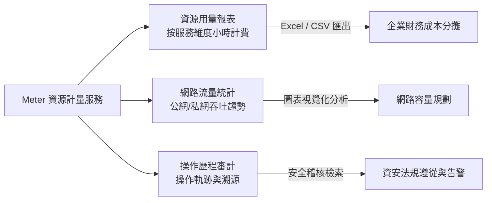

# Meter 資源計量服務 (Resource Metering & Audit)

本文件彙整自《FiXo User Portal Manual v5.4.1.0》第 13 章，說明 FiXo 平台的用量多維度統計、成本費用分攤、網路頻寬流向監控與全域操作審計日誌。

---

## 🌟 3D 政策島（Heart Island）場景導覽
* **3D 展館地標**：📈 **綠能港灣光伏計量站**
* **六角島嶼座標**：Axial Hex `(q: 1, r: 1)` ｜ 3D 世界座標：`(22.1, 0.65, 12.8)`
* **所屬聚落**：高雄軟體科技園區 · 最南端綠能光電浮島
* **場景建築概念**：全島鋪設大面積太陽能光電陣列板與旋轉綠能風力計量雷達，象徵綠色雲端計算（Green Computing）與 FinOps 財務維運精準計量。
* **探索互動方式**：探索員小人抵達最南端光伏島，觸發地標信標即可調閱手冊內容，了解小時計費規格時數（vCPU/RAM/磁碟/IP）、Excel/CSV 財務成本報表匯出、公網/私網流量雙軌分析及 ISO 27001 六大欄位操作歷程審計日誌。

---

## 1. 產品定位與治理價值

Meter（Resource Metering Service）為企業 IT 管理者與財務部門提供透明化、可量化的資源使用統計與操作軌跡追蹤。支援 IT 成本分攤（Chargeback / Showback）、網路流量負載診斷，以及滿足資安合規要求的全維度操作歷程審計。

---

## 2. 資源計量報表 (Usage Reports)

### 2.1 時間維度與自訂查詢
* **快捷區間**：提供「當月」、「上月」快速切換。
* **自訂時間範圍**：支援任意自訂開始日期與結束日期，以利配合企業特定的財務會計結算週期。

### 2.2 跨產品維度計量指標
報表明細依據各底層雲端產品，精確計算資源佔用時間與容量：
* **FiCo 計算服務**：統計虛擬機規格時數（vCPU-Hours、RAM-Hours）。
* **雲磁碟與快照**：統計磁碟容量時數（GB-Hours）。
* **VPC 網路服務**：統計浮動 IP 保留時數與通訊埠佔用。
* **其他高階服務**：包含 Kubernetes 節點群、大數據 BDS 叢集與 FiWo 桌面工作區用量。

### 2.3 報表匯出功能
* 支援將統計數據一鍵匯出為 **Excel（.xlsx）** 或 **CSV** 格式，利於企業對接 ERP 系統或內部計費分析軟體。

---

## 3. 網路用量分析 (Network Usage)

* **公網 vs. 私網雙軌監控**：
  * 分別呈現跨專案、個別虛擬機的 **公網進出流量（Public Egress/Ingress）** 與 **內部私網傳輸量（Private Traffic）**。
* **圖表視覺化趨勢**：透過時間序列折線圖即時反應流量峰值，輔助判斷頻寬瓶頸或異常流量暴增。
* **歷史數據導出**：支援定期匯出網路用量歷史檔，供網路維運團隊進行容量規劃。

---

## 4. 全平台操作歷程審計 (Audit Log)

操作歷程提供專案層級的所有使用者操作行為紀錄，是通過 ISO 27001、SOC 2 等資安標準的重要稽核基礎。

### 4.1 六大核心記錄欄位
每筆審計事件均精確記錄以下資訊：
1. **操作時間（Timestamp）**：精確至秒級的時間戳記。
2. **操作者帳號（User Account）**：觸發操作的使用者識別碼或 Email。
3. **來源 IP 位址（Source IP）**：發起請求之終端真實 IP。
4. **雲端服務類型（Service Type）**：如 FiCo、VPC、FiBo、LBS 等。
5. **操作動作（Action）**：如建立虛擬機、掛載雲磁碟、修改安全群組規則、刪除路由器等。
6. **執行結果（Result Status）**：標明「成功（SUCCESS）」或「失敗（FAILED）」及錯誤原因。

### 4.2 檢索與事後鑑識
* 支援依使用者帳號、操作動作類別（新增/修改/刪除）及特定時間範圍進行複合篩選，當發生資源誤刪或資安異常時，能於數分鐘內精確定位操作源頭與事件原因。
